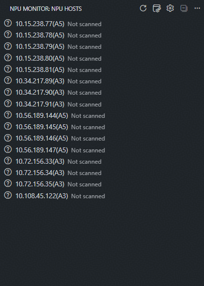

# NPU Monitor for VS Code

English | [简体中文](README.zh-CN.md)

Monitor Ascend NPUs and Docker containers across multiple SSH hosts from VS Code.
The extension supports native Windows and WSL OpenSSH, with Chinese and English
interfaces that follow the VS Code language setting.

## Features

- Load hosts automatically from an OpenSSH configuration file.
- Find hosts by alias, address or local note; pin favorites and filter the host list.
- Refresh NPU status for all hosts automatically, or scan all, one, or selected hosts manually.
- Track per-NPU idle history and choose hosts by observed continuous idle time.
- Subscribe to idle notifications; containers refresh on startup and manual scans.
- Prefer NPU-Exporter `/metrics` and quickly fall back to `npu-smi info`.
- Display health, utilization, HBM, temperature, power, and processes per physical NPU.
- Monitor Docker containers with Dev Container and workspace directory filters.
- Copy SSH host connection information from the host context menu.
- Open running containers in a new window and copy container information.
- Distinguish connection timeouts, authentication failures, host key errors,
  and collection failures.

The first automatic scan collects NPU and container data from all configured hosts by default.
Periodic scans refresh NPU data only; subscribed hosts receive idle notifications.
Manual scans refresh both data types without changing subscriptions.



## Requirements

- VS Code 1.100 or later.
- Windows OpenSSH Client or `/usr/bin/ssh` in WSL.
- Passwordless access to the hosts configured in the SSH configuration file.
- `npu-smi` installed on each remote host, or an accessible NPU-Exporter
  process running there.
- For container monitoring: Docker access for the remote SSH user; no local Docker required.
- To open containers: Dev Containers and Remote - SSH installed in local VS Code.

## Build and Install

Build from source with Node.js 24 LTS (`npm run vsix` includes all checks):

```bash
npm ci
npm run vsix
code --install-extension release/vscode-npu-monitor-0.2.5.vsix
```

The same VSIX can be installed in either a local Windows Extension Host or a
WSL Extension Host. For a WSL workspace, select **Install in WSL** in VS Code.

## Usage

1. Open **NPU Monitor** in the Activity Bar.
2. On first use, the extension loads the SSH configuration and scans all hosts
   for NPU and container status.
3. Select the refresh icon in the view title to scan all hosts. Reload the SSH
   configuration from the title bar’s More Actions menu.
4. Use the refresh icon on a host to scan it, or select multiple hosts and run
   **Scan Selected Hosts**.
5. Right-click a host to open an SSH terminal or copy its connection information;
   copying supports multiple selected hosts.
6. Select the bell icon to subscribe to a host. It is scanned immediately; periodic
   NPU scans can send idle notifications.
7. Use the title-bar **Find Host** button to search all hosts by alias, address or note,
   then reveal and expand the selected host. Use **Filter Hosts → Hosts with idle NPUs**
   to rank fresh candidates by their longest observed per-card continuous idle time.
   The history icon beside each host's bell shows its per-NPU timeline, newest day first.
8. Host rows show idle NPU count, longest observed idle time, collection time and
   container count. Hover for full status and collection source. Expand a host to view
   NPU and container status. Use a running container's
   new-window icon to attach in a separate VS Code window.
9. Use a container's copy icon for **Copy Summary**, or the context menu for
   **Copy Full Information**. Both support multiple selected containers.

Startup and manual scans collect NPU data first, followed by read-only Docker queries. Dev Containers
are shown by default and use the configured project name when available. Failed
scans retain the last successful data with a **Stale** marker. Idle history is stored
locally in the current extension environment; a failed,
partial, or overdue observation never extends a continuous idle period. Changing the
per-card idle threshold or process rule starts a new history under the new rule.

Remote - SSH must use the same SSH configuration and host aliases as NPU Monitor
when opening a container.

### Finding and organizing hosts

- **Find Host** searches all loaded hosts, regardless of the active tree filter. Favorites
  appear first, followed by natural host-name order. Results show the address, note and
  cached NPU status. Selecting a hidden result clears the filter before revealing it;
  cancelling search preserves the filter and selection.
- Right-click one or more hosts to **Favorite Hosts** or **Unfavorite Hosts**. Favorites
  appear once at the top of ordinary lists with a star, independently of idle notifications.
  Right-click one host to **Edit Host Note**; an empty note removes it.
- **Filter Hosts** offers All hosts, Favorite hosts, Subscribed hosts, Hosts with idle NPUs,
  NPU errors and Stale NPU data. The message above the tree shows the current filter and
  visible/total host counts. **Clear Host Filter** restores all hosts. Filters reset when
  the window reloads; MCP status is always visible and is not included in host counts.
- The idle filter requires a complete, fresh NPU snapshot and matching per-card history,
  and always means at least one idle card, regardless of the
  notification `idleScope`. It sorts by the longest idle time, then idle card count, then
  natural host name. Other filters put favorites first. Unconfirmed idle counts show `?`.
- NPU errors include connection/collection failures, unhealthy devices, partial data,
  missing collectors and missing SSH configuration. Stale NPU data requires a previous
  snapshot that failed to refresh or exceeded twice the polling interval. Unscanned
  hosts are not stale. Errors and stale data can overlap; Docker failures stay independent.
- Favorites and notes are stored locally across workspaces in the current extension
  environment, keyed by SSH configuration path and host alias. Windows and WSL do not
  automatically share them. They do not edit SSH configuration or rename hosts.
- Search, preferences and filters only use cached data. Cache updates and NPU expiry
  update the view without starting SSH queries or changing subscriptions. **Scan All Hosts**
  always scans all configured hosts, including those hidden by a filter.

### MCP access

Enable MCP from the status row at the top of NPU Monitor. MCP clients can
read cached hosts and containers, or explicitly refresh selected hosts. The service
uses an authenticated loopback endpoint (default port `49160`) and stops with the window.
Only one window can listen on a given port; clients should run in the same environment.

Choose **Copy MCP environment variables** to obtain the endpoint and token. Configure
your client to use Streamable HTTP with the URL from `NPU_MONITOR_MCP_URL` and an
`Authorization: Bearer <token>` header using `NPU_MONITOR_MCP_TOKEN`. The copied values
contain credentials.

| Tool | Data |
| --- | --- |
| `get_overview` | Resource totals, model distribution and observation coverage |
| `query_hosts` | Filtered host summaries; searches aliases, addresses, notes and visible container metadata |
| `inspect_host` | One host section: `summary`, `devices`, `processes`, `containers`, `container` or `connection` |
| `get_history` | Per-device statistics for the last 24 hours by default; `mode: "buckets"` returns time buckets |
| `refresh_hosts` | Explicit refresh of up to 20 hosts; `scope` is `npu` (default), `containers` or `both` |

Example `query_hosts` arguments:

```json
{"query": "A3", "minIdleCards": 8, "sort": "idleDuration", "limit": 3}
```

Parameters, defaults and section-specific options are described in each tool's schema.
Queries read caches and preserve the configured container viewing scope. Idle criteria
use confirmed per-device observations, independently of notification `idleScope`.
Unknown idle quantities and missing model names are `null`.

Results contain `asOf`, `data` and, for lists, `page` with `total`, `returned` and
`nextCursor`. Lists default to 10 entries, allow up to 50, and fit a 16 KiB JSON budget.
Pass `nextCursor` as `cursor` with the same conditions to continue; the page size may
change. Cursors retain a fixed snapshot for up to two minutes. Refresh continuation
pages do not repeat collection. Reconnect clients after updating the extension.

NPU observations expire after twice the polling interval (360 seconds by default).
Containers have independent collection times and stale flags, with no fixed expiry.
Historical coverage describes observations; mixed or missing buckets are not confirmed
idle time. Cached idle status is not a resource reservation.

## Configuration

Search for `NPU Monitor` in VS Code settings:

| Setting | Default | Description |
| --- | --- | --- |
| `mcp.enabled` | `false` | Enable MCP in this workspace |
| `mcp.port` | `49160` | Loopback MCP port |
| `sshConfigPath` | Remote - SSH config or auto-detected | Explicit NPU Monitor paths have highest priority; when empty, `remote.SSH.configFile` is used before Windows / WSL auto-detection |
| `knownHostsPath` | SSH config directory and extension user's `~/.ssh` | Read existing `known_hosts` files together; explicit paths take precedence |
| `sshExecutablePath` | Auto-detected | Windows OpenSSH or `/usr/bin/ssh` |
| `connectTimeoutSeconds` | `8` | SSH connection timeout |
| `exporterProbeTimeoutSeconds` | `2` | Total Exporter probe timeout |
| `npuSmiTimeoutSeconds` | `10` | `npu-smi info` timeout |
| `maxConcurrentHosts` | `8` | Maximum hosts scanned concurrently per VS Code window |
| `excludedHosts` | `[]` | Host aliases that are hidden and never scanned |
| `devContainers.enabled` | `true` | Enable container monitoring |
| `devContainers.timeoutSeconds` | `5` | Container query timeout, excluding SSH connection time |
| `containers.filterMode` | `devContainers` | Show `all` Docker containers, `devContainers`, or filter by `workspacePaths` |
| `containers.workspacePaths` | `[]` | Host workspace directories used only in `workspacePaths` mode |
| `containers.workspaceFile` | Empty | Workspace file name to open instead of the mapped container workspace folder |
| `pollIntervalSeconds` | `180` | Automatic NPU polling interval, minimum 10 seconds |
| `autoRefreshAllHosts` | `true` | Scan NPU and containers on all hosts at startup, then poll NPU only; disabling this limits startup and polling to subscribed hosts |
| `idleHistoryRetentionDays` | `7` | Local per-NPU history retention, 1–30 days |
| `idleScope` | `anyCard` | Require all cards or any card to be idle |
| `idleRequireNoProcesses` | `true` | Require no NPU processes when determining idle state |
| `idleUtilizationThresholdPercent` | `1` | Maximum utilization considered idle |
| `idleConsecutiveChecks` | `1` | Consecutive idle checks required before notification |

SSH-related paths support `~`, `${env:NAME}`, and Windows `%NAME%` environment variables.
When WSL reads a Windows configuration, Windows paths such as `C:\...` are
converted automatically for both NPU Monitor and Remote - SSH settings.

In `workspacePaths` mode, set one or more absolute Linux directories on the
**host**. Paths match the directory and its descendants, are case-sensitive, and
do not expand `~`, variables, or wildcards. An empty list shows all Dev Containers;
the other modes ignore saved paths. Filter changes apply immediately to cached data.

```json
{
  "npuMonitor.containers.filterMode": "workspacePaths",
  "npuMonitor.containers.workspacePaths": ["/home/user", "/mnt/work/user"]
}
```

Set `containers.workspaceFile` to a file name such as
`vllm-ascend-dev.code-workspace` to open that file from the root of every mapped
container workspace. Leave it empty to keep opening the workspace folder. The name
must end in `.code-workspace` and cannot contain path separators; variables and
wildcards are not expanded. Scans only check whether the file is a regular file and
do not read its contents. Opening reports an error if the configured file is missing.

## Security

- OpenSSH host key verification is always enabled.
- The extension never accepts new host keys automatically or modifies
  SSH config, `known_hosts`, or keys.
- Scans use `BatchMode=yes` to prevent password prompts.
- Interactive SSH terminals may prompt inside the terminal, but still keep host
  key verification enabled and disable host key updates.
- Container environment variables and unrelated labels are not collected.
- Machine addresses, usernames, SSH configurations, and keys are never bundled
  into the VSIX.

## Development

See the [development guide](CONTRIBUTING.md) for setup, project structure, checks
and releases.
