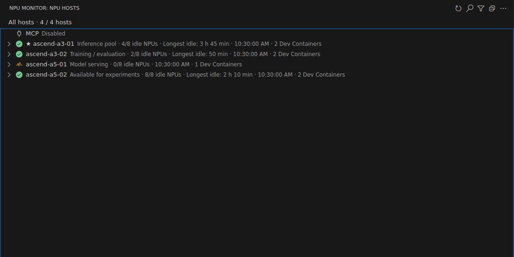
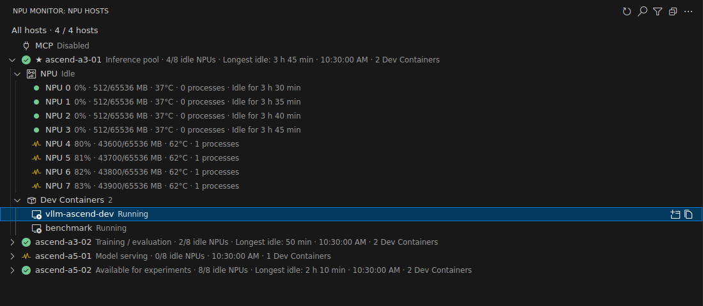
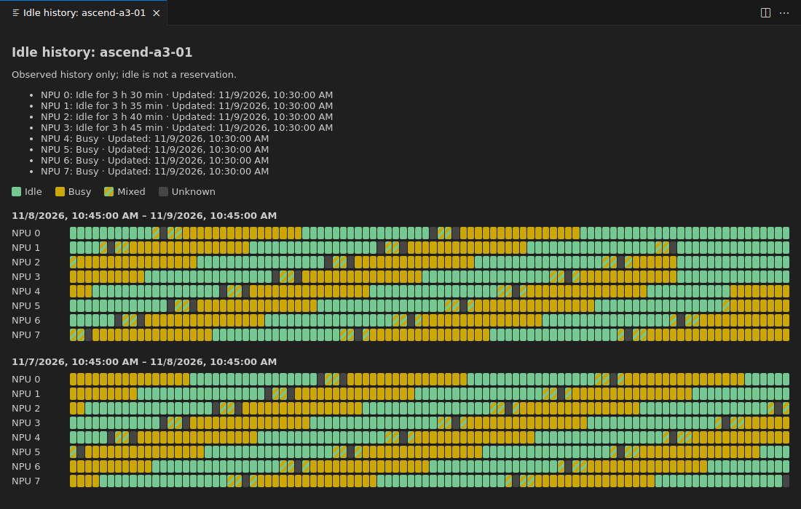

# NPU Monitor for VS Code

[English](https://github.com/li1how/vscode-npu-monitor/blob/main/README.md) | 简体中文

通过 SSH 监控多台机器上的 Ascend NPU 和 Docker 容器，支持 Windows VS Code
和 WSL VS Code。界面语言跟随 VS Code 的中文或英文设置。

## 功能

- 从 OpenSSH config 自动加载机器。
- 按别名、地址或本地备注查找节点，支持收藏置顶和快捷筛选。
- 默认自动刷新全部机器的 NPU 状态，也可手动扫描全部、单台或多选机器。
- 记录逐卡空闲历史，并按已观测的连续空闲时长选择机器。
- 订阅机器空闲提醒；启动首轮和手动扫描会刷新容器。
- 优先读取 NPU-Exporter `/metrics`，不可用时快速回退到 `npu-smi info`。
- 按物理 NPU 展示健康状态、利用率、HBM、温度、功耗和进程。
- 监控 Docker 容器，支持按 Dev Container 和工作区目录筛选。
- 通过机器右键菜单复制 SSH 连接信息。
- 在新窗口打开运行中的容器，快速复制容器信息。
- 区分连接超时、认证失败、主机密钥异常和采集失败。

默认首轮扫描全部机器的 NPU 和容器；定时只刷新 NPU，已订阅机器可接收空闲提醒。
手动扫描同时刷新两类数据，不修改订阅列表。

浏览节点、展开 NPU 和容器详情、筛选空闲候选，再从全部节点中查找目标机器：



动图和下方截图均使用模拟演示数据，界面以英文展示。

## 环境要求

- VS Code 1.100 或更高版本。
- Windows OpenSSH Client，或 WSL 中的 `/usr/bin/ssh`。
- SSH config 中配置的机器可以免密执行远端只读命令。
- 远端机器安装 `npu-smi`，或运行可访问的 NPU-Exporter。
- 容器监控需要远端 SSH 用户有 Docker 查询权限，本地无需安装 Docker。
- 打开容器需要在本地 VS Code 安装 Dev Containers 和 Remote - SSH。

## 构建和安装

使用 Node.js 24 LTS 从源码构建（`npm run vsix` 已包含全部检查）：

```bash
npm ci
npm run vsix
code --install-extension release/vscode-npu-monitor-0.2.5.vsix
```

同一个 VSIX 可以安装到 Windows 本地 Extension Host 或 WSL Extension Host。
在 WSL 工作区中，应选择 VS Code 的“Install in WSL”。

## 使用

1. 打开 Activity Bar 中的 **NPU Monitor**。
2. 首次进入时扩展加载 SSH config 并扫描全部机器的 NPU 和容器状态。
3. 点击标题栏刷新图标扫描全部机器；在标题栏的更多操作菜单中重新加载 SSH 配置。
4. 使用机器行的刷新图标扫描单台；多选机器后执行“扫描所选机器”。
5. 右键机器可打开 SSH 终端或复制连接信息；复制支持多选机器。
6. 点击铃铛订阅机器；订阅后立即扫描，定时 NPU 扫描可在空闲时提醒。
7. 点击标题栏“查找节点”，按别名、地址或备注搜索全部节点；选中后定位并展开。
   使用“筛选节点 → 有空闲卡”，按逐卡最长已观测连续空闲时长查看候选。
   点击机器行铃铛旁的历史图标，查看按天由近到远排列的逐卡时间线。
8. 机器行小字显示空闲卡数、最长已观测空闲时长、采集时间和容器数量；悬浮可查看完整状态与采集来源。
   展开机器查看 NPU 和容器状态；点击运行中容器的新窗口图标，在独立窗口附加容器。
9. 容器行的复制图标用于“复制精简信息”，右键菜单提供“复制完整信息”，均支持多选。

展开节点后，可查看逐卡利用率、HBM、温度、进程数和已观测空闲时长，以及该节点的 Dev Container：



启动首轮和手动扫描先采集 NPU 数据，再执行只读 Docker 查询。默认展示 Dev Container，并优先使用
配置中的项目名称。采集失败时保留上次成功的数据并标记“数据已过期”。空闲历史保存在
当前扩展运行环境的本地；采集失败、数据不完整或观测超时不会延长连续空闲时长。
修改逐卡空闲阈值或进程规则后，将按新规则重新积累历史。

打开容器时，Remote - SSH 需使用与 NPU Monitor 一致的 SSH 配置和主机别名。

### 查找和整理节点

- **查找节点**搜索全部已加载节点，不受当前树筛选限制。默认收藏优先，其次按名称自然排序。
  结果展示地址、备注和缓存的 NPU 状态。选中被隐藏的节点会先清除筛选再定位；取消查找保留筛选和选择。
- 右键一台或多台节点可**收藏节点**或**取消收藏**。普通列表中收藏以星标置顶，节点只出现一次，
  与空闲提醒订阅分别管理。右键单台节点可**编辑节点备注**，留空删除。
- **筛选节点**提供全部节点、收藏节点、已订阅、有空闲卡、NPU 异常、NPU 数据过期。
  树顶部显示当前筛选及“当前数量 / 总数”，点击**清除节点筛选**恢复全部。
  重载窗口后恢复“全部”；MCP 状态行始终显示，不参与节点计数。
- 空闲筛选要求完整、有效的 NPU 快照及匹配的逐卡历史，固定表示至少一张卡空闲，
  不受提醒设置 `idleScope` 影响。按最长连续空闲时长降序，再按空闲卡数降序、名称自然排序；
  其他筛选保持收藏优先。无法确认空闲数量时显示 `?`。
- NPU 异常包括连接或采集失败、设备异常、数据不完整、无采集器和 SSH 配置缺失。
  NPU 数据过期要求有历史快照，且刷新失败或超过两倍轮询周期；未扫描不算过期。
  异常和过期可以重叠，Docker 失败独立展示。
- 收藏和备注保存在当前扩展环境的本地，按 SSH 配置路径与节点别名标识，跨工作区共用。
  Windows 与 WSL 不自动同步；不会修改 SSH 配置或节点别名。
- 查找、偏好和筛选只使用缓存。缓存更新或 NPU 数据到期时更新界面，不发起 SSH 查询或修改订阅。
  **扫描全部机器**始终扫描全部已配置节点，包括被筛选隐藏的节点。

### 空闲历史

点击节点的历史图标，按天由近到远对比逐卡时间线。绿色表示空闲，黄色表示忙碌，
条纹表示混合观测，灰色表示未知；缺失的观测不能用于确认连续空闲时长。



### MCP 接入

点击面板顶部的 MCP 状态行启用服务。MCP 客户端可读取缓存的主机和容器信息，
或显式刷新指定节点。服务使用带鉴权的回环地址（默认端口 `49160`），随窗口关闭而停止；
同一端口只允许一个窗口监听，客户端应运行在相同环境中。

选择“复制 MCP 环境变量”获取地址和 token。在客户端中选择 Streamable HTTP，
使用 `NPU_MONITOR_MCP_URL` 作为地址，将 `NPU_MONITOR_MCP_TOKEN` 配置为
`Authorization: Bearer <token>` 请求头。复制内容含凭据。

| 工具 | 数据 |
| --- | --- |
| `get_overview` | 资源总数、型号分布和观测覆盖情况 |
| `query_hosts` | 筛选后的节点摘要；搜索别名、地址、备注和可见容器元数据 |
| `inspect_host` | 单节点分区：`summary`、`devices`、`processes`、`containers`、`container` 或 `connection` |
| `get_history` | 默认最近 24 小时的逐卡统计；`mode: "buckets"` 返回时间桶 |
| `refresh_hosts` | 显式刷新最多 20 个节点；`scope` 为 `npu`（默认）、`containers` 或 `both` |

`query_hosts` 参数示例：

```json
{"query": "A3", "minIdleCards": 8, "sort": "idleDuration", "limit": 3}
```

参数、默认值及分区限制见各工具的 schema。查询只读缓存，容器范围沿用配置的查看模式。
空闲条件使用已确认的逐卡观测，不受提醒设置 `idleScope` 影响；未知空闲数量和缺失型号返回 `null`。

结果包含 `asOf`、`data`；列表另有 `page`，提供 `total`、`returned`、`nextCursor`。
列表默认 10 条、最多 50 条，每份 JSON 不超过 16 KiB。保持查询条件不变，将 `nextCursor`
作为 `cursor` 继续读取，可调整页大小。游标保留固定快照，有效期最多两分钟。
刷新结果的续页不会重复采集；扩展更新后重新连接客户端。

NPU 数据有效期为两倍轮询周期，默认 360 秒。容器独立提供采集时间和失效标记，不设固定有效期。
历史覆盖率表示观测情况，混合或缺失的时间桶不算已确认空闲时间；缓存空闲状态不代表资源已被预约。

## 配置

在 VS Code 设置中搜索 `NPU Monitor`：

| 设置 | 默认值 | 说明 |
| --- | --- | --- |
| `mcp.enabled` | `false` | 启用当前工作区 MCP 服务 |
| `mcp.port` | `49160` | MCP 回环监听端口 |
| `sshConfigPath` | Remote - SSH 配置或自动检测 | 显式配置的 NPU Monitor 路径优先级最高；留空时先使用 `remote.SSH.configFile`，再按 Windows / WSL 规则自动检测 |
| `knownHostsPath` | SSH config 同目录及插件用户 `~/.ssh` | 联合读取现存 `known_hosts`；显式配置优先 |
| `sshExecutablePath` | 自动检测 | Windows OpenSSH 或 `/usr/bin/ssh` |
| `connectTimeoutSeconds` | `8` | SSH 连接超时 |
| `exporterProbeTimeoutSeconds` | `2` | Exporter 总探测时间 |
| `npuSmiTimeoutSeconds` | `10` | `npu-smi info` 超时 |
| `maxConcurrentHosts` | `8` | 每个 VS Code 窗口同时扫描的最大机器数 |
| `excludedHosts` | `[]` | 不显示、不扫描的 Host 别名 |
| `devContainers.enabled` | `true` | 启用容器监控 |
| `devContainers.timeoutSeconds` | `5` | 容器查询超时，不含 SSH 连接时间 |
| `containers.filterMode` | `devContainers` | `all` 全部容器、`devContainers` 或 `workspacePaths` 工作区筛选 |
| `containers.workspacePaths` | `[]` | 宿主机工作区目录，仅在 `workspacePaths` 模式生效 |
| `containers.workspaceFile` | 空 | 用于替代容器工作目录打开的 Workspace 文件名 |
| `pollIntervalSeconds` | `180` | NPU 自动轮询周期，最小 10 秒 |
| `autoRefreshAllHosts` | `true` | 启动首轮扫描全部机器的 NPU 和容器，之后仅定时扫描 NPU；关闭后只扫描已订阅机器 |
| `idleHistoryRetentionDays` | `7` | 逐卡历史在本地保留的天数，范围 1–30 |
| `idleScope` | `anyCard` | 要求全部卡或任一卡空闲 |
| `idleRequireNoProcesses` | `true` | 空闲时要求没有 NPU 进程 |
| `idleUtilizationThresholdPercent` | `1` | 空闲利用率上限 |
| `idleConsecutiveChecks` | `1` | 空闲提醒前连续满足次数 |

SSH 相关路径支持 `~`、`${env:NAME}` 和 Windows `%NAME%` 环境变量。WSL 读取 Windows
配置时会自动转换 NPU Monitor 和 Remote - SSH 设置中的 `C:\...` 路径。

在 `workspacePaths` 模式下，填写一个或多个**宿主机** Linux 绝对目录，匹配该目录
及其子目录，区分大小写，不展开 `~`、变量或通配符。空列表显示全部 Dev Container，
其他模式忽略已保存的路径。筛选修改立即作用于缓存数据。

```json
{
  "npuMonitor.containers.filterMode": "workspacePaths",
  "npuMonitor.containers.workspacePaths": ["/home/user", "/mnt/work/user"]
}
```

将 `containers.workspaceFile` 设置为 `vllm-ascend-dev.code-workspace` 之类的文件名，
可从每个已映射容器工作目录的根目录打开该文件；留空时仍打开工作目录。文件名必须以
`.code-workspace` 结尾且不能包含路径分隔符，不展开变量或通配符。扫描只检查该文件
是否为普通文件，不读取文件内容；配置的文件不存在时，打开操作会明确报错。

## 安全行为

- 始终启用 OpenSSH 主机密钥校验。
- 不自动接受新密钥，不修改用户的 SSH config、`known_hosts` 或密钥。
- 扫描使用 `BatchMode=yes`，不会弹出密码输入。
- 交互式 SSH 终端可以在终端中提示输入，但仍启用主机密钥校验并禁用主机密钥更新。
- 不采集容器环境变量和无关标签。
- 不把机器地址、用户名、SSH 配置或密钥打包进 VSIX。

## 开发相关

环境准备、项目结构、检查和发布流程见[开发指南](CONTRIBUTING.zh-CN.md)。
界面更新后，运行 `npm run docs:capture`
[刷新 README 动图和截图](CONTRIBUTING.zh-CN.md#刷新-readme-图片)。
